# Old website reference — greaterefwc.com

A capture of everything on the church's previous website (built on **Clover Sites**), made on **2026-11-14** before the domain moves to the new Netlify site. Use it to check facts, wording, and how things used to work.

- **Source:** https://www.greaterefwc.com/ (Clover site name `greateremmanuelfamilyworshipcenter`, design "Bloom", built 2016)
- **Images:** saved in [`old-website/images/`](old-website/images/) (33 files). Original Clover URLs are listed in the [image index](#image-index), but those stop working once the Clover account closes.
- **Not saved locally:** the new-member course videos (MP4/MP3 hosted by Clover) — links only. See [Before cancelling Clover](#before-cancelling-clover).

---

## Quick facts

| | |
|---|---|
| **Name** | Greater Emmanuel Family Worship Center (GEFWC, "Greater E") |
| **Tagline** | "Love Lives HERE!" |
| **Address** | 3915 Kelley St, Houston, TX 77026 — [map link](https://goo.gl/maps/QkEcHHD9P462) |
| **Phone** | 713-635-2501 |
| **Office hours** | Tuesday–Friday, 8:30 AM – 3:00 PM |
| **Senior pastors** | Bishop (Dr.) Titus B. Stewart and Lady Tamesha "Tammy" Stewart |
| **Sunday** | 8:45 AM DEVELOP & DEVELOP Kids (Christian education) · 10:00 AM Morning Worship Service |
| **Children & youth** | Sundays 10:00 AM in the Gibson-Stewart Fellowship Hall. Kingdom Kids' Ministry (ages 3–12) 1st & 3rd Sundays; IGNITE Youth Ministry (middle & high school) 2nd & 4th Sundays. Parent/guardian check-in and check-out required. |
| **Bible study** | **Tuesdays** 7:00–8:00 PM — "Made Alive" Bible Study, on Facebook Live and YouTube |
| **Prayer lines** | "Seek His Face" Faith & Miracle Prayer Line — Wednesdays 6:00–6:45 AM, dial (717) 275-8940, code 673-9981 · Women With Purpose Prayer Line — Fridays 5:30 AM CST, dial (480) 660-2224, code 567-4306 _(from home-page slides; may be out of date)_ |
| **Mission** | To love God and love people. To reach each person with love and bring them in with grace and truth. To teach and equip souls, preparing them for KINGDOM living. |
| **Vision** | A KINGDOM church where purpose is found, lives are changed, and love abounds. |
| **Giving** | Pushpay: https://pushpay.com/g/greaterefwc · Text GEFWC to 77977 · Cash App $GEFWC7 (from video descriptions) |
| **Church app** | Text **gefwapp** to 77977 (Get the App graphic) — the Give graphic says **GEFWCAPP**; one of them is a typo. "Available in the App Store." |
| **Facebook** | https://www.facebook.com/gefwc |
| **YouTube** | "Greater Emmanuel Family Worship Center" channel (videos listed under [Media](#media)) |
| **Other ministry site** | TB Stewart Ministries — http://www.tbstewartministries.org (bookstore: https://www.tbstewartministries.org/store) |
| **New-member forms** | Application: https://form.jotform.com/221088360971054 · Survey: https://www.surveymonkey.com/r/SHH3JXM · Spiritual gifts: https://gifts.churchgrowth.org/spiritual-gifts-survey/ · Email: NewMembers.GreaterE@gmail.com |
| **Women's ministry** | "Women With Purpose" (directed by Lady Tammy Stewart) |
| **Denomination cues** | Apostolic / Oneness Pentecostal (baptism in Jesus' name, strict monotheism, speaking in tongues) — see [What We Believe](#explore--what-we-believe) |

### Differences from the new site worth checking

- **Phone:** the old site says **713-635-2501**; the new design shows (713) 671-9994.
- **Bible study:** the old site and calendar say **Tuesdays**; the new design's Visit section says Wednesdays.
- **Email:** the old site lists no general church email. The new design's `info@greateremmanuel.org` doesn't appear anywhere on it. The only email found is NewMembers.GreaterE@gmail.com.
- **Sunday schedule:** the old site also lists the 8:45 AM DEVELOP classes, which the new site doesn't mention.

---

## Site map

The old navigation, with where each URL now redirects on the new site (see `netlify.toml`).

| Menu | Old URL | Redirects to |
|---|---|---|
| CONNECT (home) | `/` and `/connect` (same page) | `/` |
| EXPLORE › What We Believe | `/explore/what-we-believe` | `/#believe` |
| EXPLORE › Bishop Titus Stewart | `/explore/bishop-titus-stewart` | `/#pastors` |
| EXPLORE › Lady Tammy Stewart | `/explore/lady-tammy-stewart` | `/#pastors` |
| EXPLORE › Plan A Visit | `/explore/plan-a-visit` | `/#visit` |
| EXPLORE › Book Store | https://www.tbstewartministries.org/store (external) | — |
| EVENTS | `/events` | `/#events` |
| MEDIA | `/media` | `/#gallery` |
| MEDIA › Children's Church | `/media/childrens-church` | `/#gallery` |
| MEDIA › Views from the Pew | `/media/views-from-the-pew` | `/#gallery` |
| GIVE | `/give` | `/#give` |
| NEW MEMBER | `/new-member` | `/#visit` |
| NEW MEMBER › New Member's Application | `/new-member/new-members-application` | `/#visit` |
| NEW MEMBER › New Members Courses | `/new-member/new-members-courses` | `/#visit` |
| NEW MEMBER › Next Steps | `/new-member/next-steps` | `/#visit` |
| MMV 1st Annual Cruise | `/mmv-1st-annual-cruise` | `/#events` |

## SEO metadata (as it was)

Clover generated each page's description from the first lines of its text.

| Page | `<title>` | Meta description | Share image |
|---|---|---|---|
| `/` | Greater Emmanuel Family Worship Center \| CONNECT | Welcome To Greater Emmanuel!"Love Lives Here!" | [image](https://s3.amazonaws.com/media.cloversites.com/f5/f5d043e9-b9dc-44b2-af8a-526890433993/gallery/slides/387b59d8-4988-4d8c-908f-5931f3db8abb.png) |
| `/explore/what-we-believe` | Greater Emmanuel Family Worship Center \| What We Believe | What We Believe - We Are A Family Of Believers That Magnify God’s Presence In Triumphant Worship. | [image](https://s3.amazonaws.com/media.cloversites.com/f5/f5d043e9-b9dc-44b2-af8a-526890433993/backgrounds/ae460f99-bd44-4bda-82a3-c05fe75a7a31.jpg) |
| `/explore/bishop-titus-stewart` | Greater Emmanuel Family Worship Center \| Bishop Titus Stewart | Bishop Titus B. Stewart - Pastor Titus Stewart Is One Whom Exemplifies Excellence In Every Aspect Of His Life. He Is Very Passionate About Building God's | [image](https://s3.amazonaws.com/media.cloversites.com/f5/f5d043e9-b9dc-44b2-af8a-526890433993/site-images/1b514cb3-fcf4-4a42-ae9a-6fbb3216771f.jpg) |
| `/explore/lady-tammy-stewart` | Greater Emmanuel Family Worship Center \| Lady Tammy Stewart | Meet Lady Stewart - Tamesha "Tammy" Stewart Is The Leading Lady At Greater Emmanuel Family Worship Center. She Has Faithfully Assisted Her Husband, | [image](https://s3.amazonaws.com/media.cloversites.com/f5/f5d043e9-b9dc-44b2-af8a-526890433993/site-images/b88536e5-8626-4490-9d05-3c97b375228c.jpg) |
| `/explore/plan-a-visit` | Greater Emmanuel Family Worship Center \| Plan A Visit | Join Us - Click For Directions3915 Kelley St Houston, Tx 77026 713 635 2501administrative Office Hourst F  8:30 A.M.  3:00 P.M. Sunday 8:45 A.M. Develop ... | [image](https://s3.amazonaws.com/media.cloversites.com/f5/f5d043e9-b9dc-44b2-af8a-526890433993/site-images/7d87dbfb-ff93-4c83-9480-9c3322f6c5f4.jpg) |
| `/events` | Greater Emmanuel Family Worship Center \| EVENTS | This is a page on the Greater Emmanuel Family Worship Center website. Check it out! |  |
| `/media` | Greater Emmanuel Family Worship Center \| MEDIA | Greater E Worship Experiences | [image](https://i3.ytimg.com/vi/zIFEXvxKuk8/mqdefault.jpg) |
| `/media/childrens-church` | Greater Emmanuel Family Worship Center \| Children's Church | Children's Church | [image](https://i3.ytimg.com/vi/Ss2Gn-ggVlg/mqdefault.jpg) |
| `/media/views-from-the-pew` | Greater Emmanuel Family Worship Center \| Views from the Pew | The View From The Pew - Please Enjoy The Various Updates From The Services That Happen Weekly Here At  Greater E!  | [image](https://s3.amazonaws.com/media.cloversites.com/f5/f5d043e9-b9dc-44b2-af8a-526890433993/gallery/slides/47bf503c-3c48-4046-b5fa-23b5eb97492f.JPG) |
| `/give` | Greater Emmanuel Family Worship Center \| GIVE | Click To Give - 10 Bring The Whole Tithe Into The Storehouse, That There May Be Food In My House. Test Me In This,” Says The Lord Almighty, “And See If I Wil... | [image](https://s3.amazonaws.com/media.cloversites.com/f5/f5d043e9-b9dc-44b2-af8a-526890433993/site-images/36602ec5-6eec-406f-ae83-34fbea12516e.png) |
| `/new-member` | Greater Emmanuel Family Worship Center \| NEW MEMBER | Welcome To Greater Emmanuel! - We're So Glad That You've Decided To Be Apart Of Our Family! Please Follow These Steps To Complete The New Member's | [image](https://s3.amazonaws.com/media.cloversites.com/f5/f5d043e9-b9dc-44b2-af8a-526890433993/site-images/c7337078-347b-49d9-b8f6-cca3dd861397.JPG) |
| `/new-member/new-members-application` | Greater Emmanuel Family Worship Center \| New Member's Application | Please Click The Link Below -        New Member's Form      |  |
| `/new-member/new-members-courses` | Greater Emmanuel Family Worship Center \| New Members Courses | Welcome To The Family! - We Are So Glad That You Have Made The Decision To Be Apart Of The Greater Emmanuel Family!  Below You Will Find Some Videos The Will... | [image](https://clovermedia.s3.us-west-2.amazonaws.com/store/fa6fe996-fa0b-46f8-b536-9406160d00a4/a6bc8760aa/thumbnails/original/0000.jpg) |
| `/new-member/next-steps` | Greater Emmanuel Family Worship Center \| Next Steps | Welcome To The Family! - Now That You've Completed The New Member's Courses We Ask That You Would Please Do The Following:Take The New Member's | [image](https://clovermedia.s3.us-west-2.amazonaws.com/store/fbfd5079-3db0-4130-b2ff-672b9695a772/ebc24ff2a3/thumbnails/original/0000.jpg) |
| `/mmv-1st-annual-cruise` | Greater Emmanuel Family Worship Center \| MMV 1st Annual Cruise | This is a page on the Greater Emmanuel Family Worship Center website. Check it out! |  |

Other head details: favicon `/blank.ico` (blank), no structured data, no canonical tag. Google Search Console is verified on the domain by DNS TXT record (`google-site-verification=xdXH2DXBZaNGKal38ZZMgTtK7W0eOegs5lFcHTqAc6k`) — keep it when DNS changes.

---

# Pages

---

## Home (CONNECT)

`https://www.greaterefwc.com/` · page title: _Greater Emmanuel Family Worship Center | CONNECT_

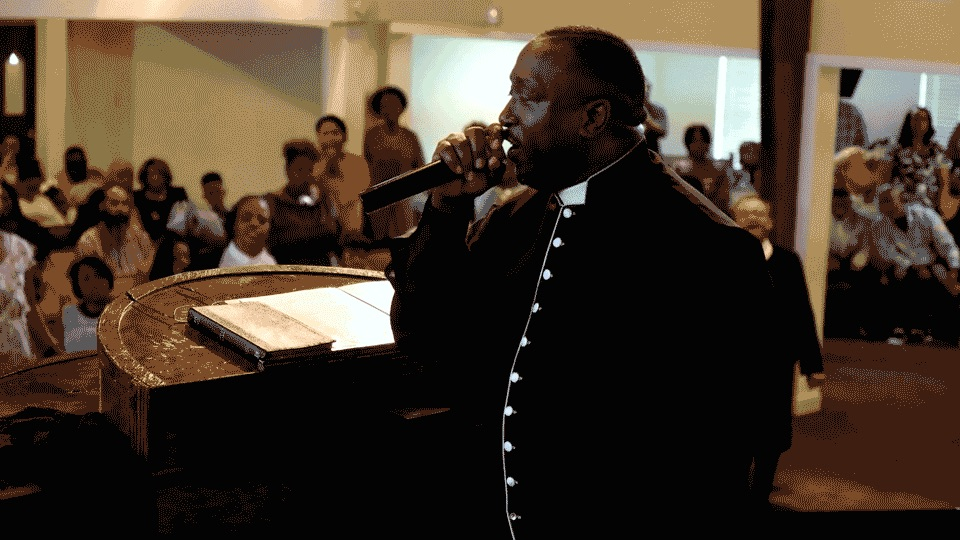
_Home page animated background — congregation in worship (still frame; original is an animated GIF)_

Welcome to Greater Emmanuel!

"Love Lives HERE!"

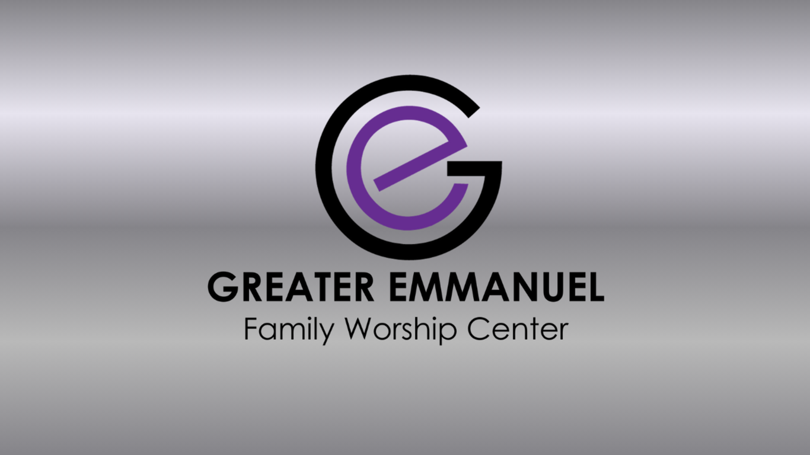
_Home slideshow — Greater Emmanuel logo slide_

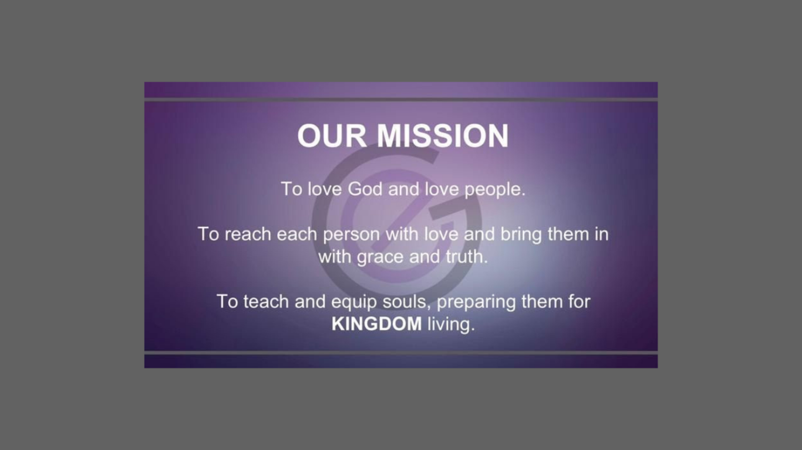
_Home slideshow — "Our Mission" slide_

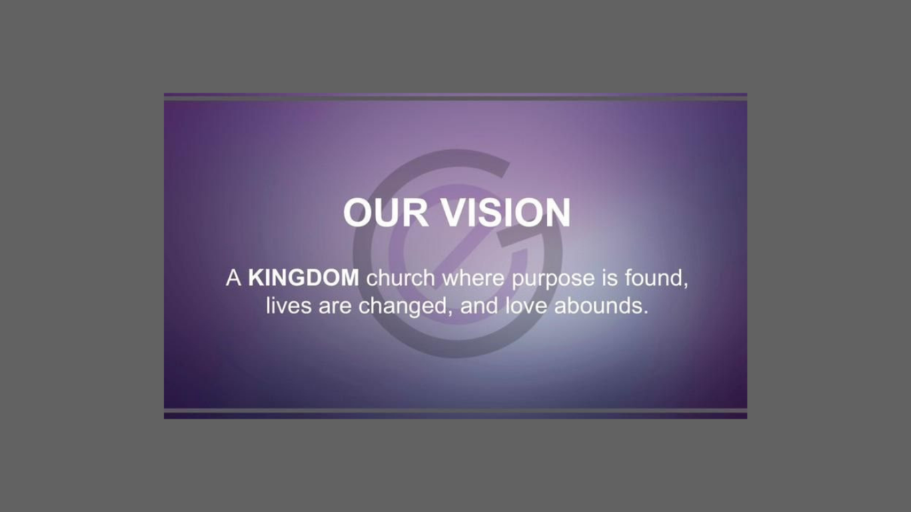
_Home slideshow — "Our Vision" slide_

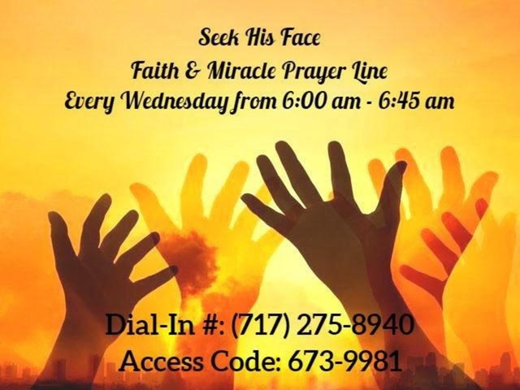
_Home slideshow — "Seek His Face" Faith & Miracle Prayer Line flyer_

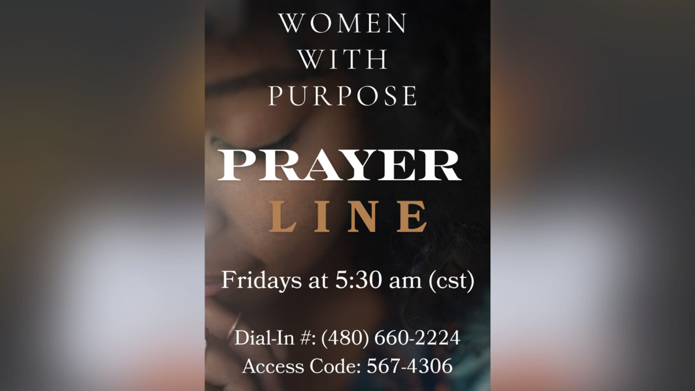
_Home slideshow — Women With Purpose Prayer Line flyer_

Upcoming Events

_This page showed a live list of upcoming events from the church's Clover calendar — see **Events calendar** below._

---

## Explore › What We Believe

`https://www.greaterefwc.com/explore/what-we-believe` · page title: _Greater Emmanuel Family Worship Center | What We Believe_

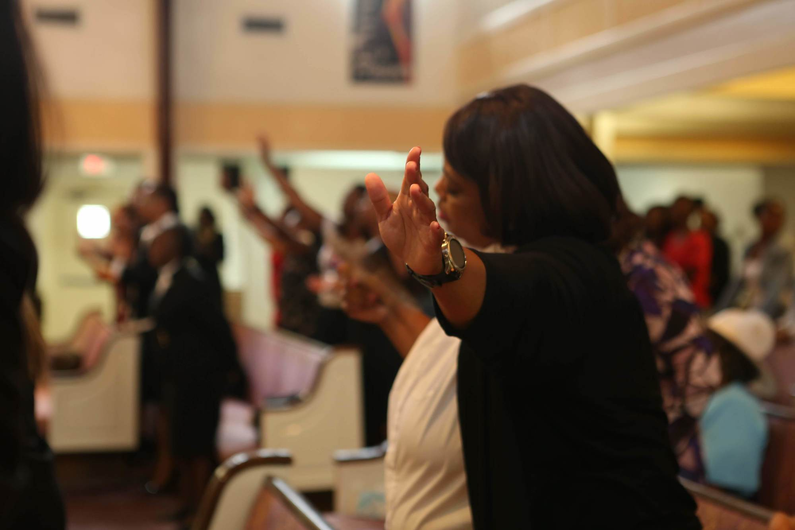
_What We Believe — header background (congregation in worship)_

What We Believe

We are a family of believers that magnify God’s
Presence in triumphant worship.

We believe the one baptism as recorded in Acts 2:4; 10:44; 19: 1- 6.

The new birth (being born again) includes a genuine repentance, water baptism in Jesus' name and the baptism of the Holy Spirit, evidenced by speaking in other tongues as the spirit gives utterance. In administering the Baptism in Jesus name, our formula should include, "In the name of the Lord Jesus Christ for the remission of sin." Acts 2:36 -38.

We believe the Bible to be the inspired Word of God and to be free from error in the original manuscripts when all grammatical, historical literary and culture issues have been considered. We believe the bible is the only God- given authority which man posses; therefore, all doctrine, faith, hope and all instruction for the church must be based upon and harmonized with the bible. (2 -Timothy 3:16; 2 Peter 1:20-21)

God in Strict Monotheism -that God is numerically one. (Deuteronomy 6:4; 2 Corinthians 13:14; 1 Timothy 1:17; 3:16; 6:13-16)

Jesus Christ - That the one God of the Old Testament, whose name is Yahweh, became a man in the person of Jesus Christ. Jesus, the Son of God, is both fully God and fully man, being the visible image of the one invisible God. Jesus deity is none other than that of the father . As it pertains to His humanity, Jesus was born of a virgin in time. (Acts 10: 28-40; 1 Corinthians 15: 1 - 5; Colossians 2: 9)

The Holy Spirit is none other than the Spirit of God Himself, primarily as He relates to mankind on our adoption as children of God and in our sanctification. (Acts 2: 1 -4; 2: 39; 8: 17; 10:44-46; 19:5; Joel 2: 28 - 29; Isaiah 28:11)

Salvation is based solely on the substitutionary death of Jesus Christ and is completely an undeserved gift of God. The Biblical experience of salvation consists of: faith, repentance, baptism in water by immersion in the Name of the Lord Jesus Christ for the remission of sins, and the baptism of the Holy Spirit with the initial sign of speaking with other tongues as the Spirit gives utterance. (Acts 2:1 -39; 10:40 -48)

The Second Coming - Jesus died for our sins, was resurrected and ascended into heaven where He presently reigns. We also believe in a literal, bodily return of Jesus Christ after a time of Great Tribulation, both to claim his bride and to execute vengeance on an unbelieving world. (1 Corinthians 15:51-51; 1-Thessalonians 4:13-18)

Final Judgement - There is coming a time when all who ever lived will stand before Jesus Christ to be judged and that all who are not saved will be cast into the lake of fire. We believe this judgement to be literal and eternal.

(Romans 14:10-12; 2 Thessalonians 1: 6-10; Revelation

> _The text ends here on the old site itself — the last reference was cut off there, not in this capture._

---

## Explore › Bishop Titus Stewart

`https://www.greaterefwc.com/explore/bishop-titus-stewart` · page title: _Greater Emmanuel Family Worship Center | Bishop Titus Stewart_

_Bishop Titus Stewart page — header background (preaching)_

_Bishop Titus B. Stewart — portrait_

Bishop Titus B. Stewart

Pastor Titus Stewart is one whom exemplifies excellence in every aspect of his life. He is very passionate about building God's people in order to build God's Kingdom.

Preaching the unadulterated word of God confidently and zealously, this visionary is determined to push individual's to reaching their fullest potential. He has an anointing on his life, and wealth of wisdom that identifies him as the "preacher's preacher". Integrity and humility are characteristic traits that he is known for, and because of it he is sought after throughout the states.

Pastor Stewart is the senior pastor of Greater Emmanuel Family Worship Center. He has been pastoring for more than ten years. God has blessed him with an innate ability to lead God's people in this 21st century. An unorthodox sense of creativity has allowed him to reach many people from many walks of life. In this, God has added 100's to the church through his ministry. Having been the successor of his powerful father, Suffragan Bishop Clarence Stewart (Evangelist Carrie Stewart, mother), Pastor Stewart began to fill humongous shoes. But with God's Grace, the Greater Emmanuel Family Worship Center is growing spiritually and numerically under his leadership.

Pastor Stewart received his Bachelor's of Theology from Christian Bible Institute. In 2016 he received dual degrees; Master’s and Doctorate of Theology also from Christian Bible Institute. He is a entrepreneur, master musician, song writer and singer.

He is married to Lady Tammy Stewart, and fathers their son, Trenton.

_TB Stewart Ministries — banner background_

[
_TB Stewart Ministries — logo (linked to tbstewartministries.org)_](http://www.tbstewartministries.org/)

TB Stewart Ministries

The purpose of TB Stewart Ministries, INC. is to teach people how to make their dreams bigger than their insecurities, failures and weaknesses and to fulfill God's assignment on their lives.

[Connect With TB Stewart Ministries](http://www.tbstewartministries.org)

---

## Explore › Lady Tammy Stewart

`https://www.greaterefwc.com/explore/lady-tammy-stewart` · page title: _Greater Emmanuel Family Worship Center | Lady Tammy Stewart_

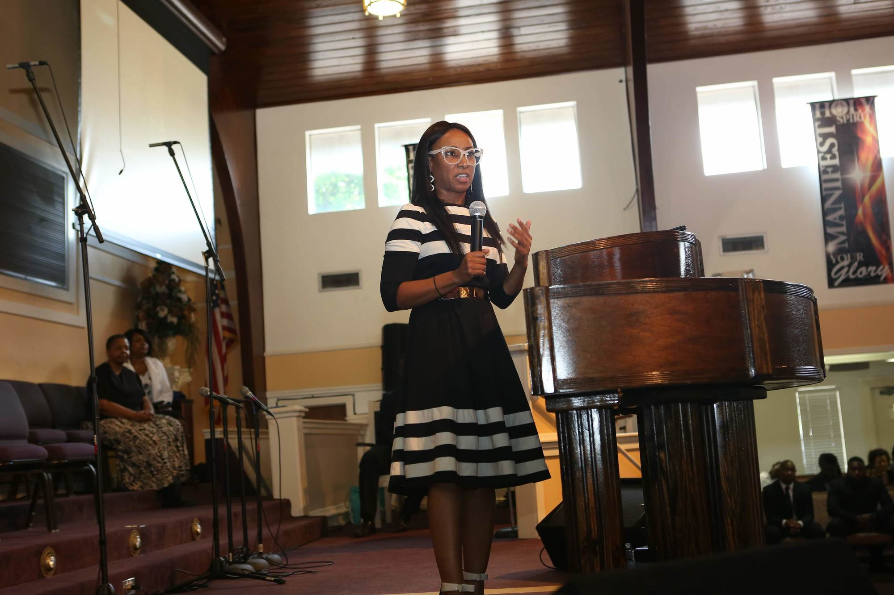
_Lady Tammy Stewart page — header background (ministering at the pulpit)_

_Lady Tammy Stewart — portrait_

Meet Lady Stewart

Tamesha "Tammy" Stewart is the leading lady at Greater Emmanuel Family Worship Center. She has faithfully assisted her husband, Pastor Titus Stewart, for almost 15 years in both ministry and marriage.

Lady T, as their ministry affectionately calls her, compassionately serves as a midwife in coaching and mentoring women to tap into their Divine purpose. She serves as the Director of their churches Women's Ministry, in which is called, "Women With Purpose". She ministers with both spiritual and practical tools to awaken the potential inside each woman.

Alongside her husband, Lady T handles her obligation to serve in ministry with superb devotion. She is a proud mother of their son Trenton, who serves in the United States Air Force. She is also the grandmother of Trinity, her pride and joy!

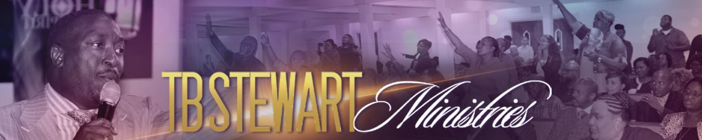
_TB Stewart Ministries — banner background_

[
_TB Stewart Ministries — logo (linked to tbstewartministries.org)_](http://tbstewartministries.org)

TB Stewart Ministries

The purpose of TB Stewart Ministries, INC. is to teach people how to make their dreams bigger than their insecurities, failures and weaknesses and fulfill God's assignment on their lives.

---

## Explore › Plan A Visit

`https://www.greaterefwc.com/explore/plan-a-visit` · page title: _Greater Emmanuel Family Worship Center | Plan A Visit_

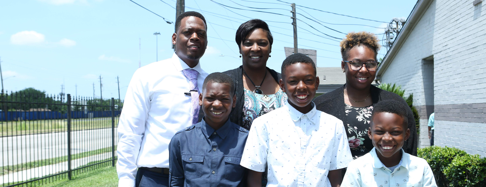
_Plan A Visit — header background (group photo outdoors)_

Join Us

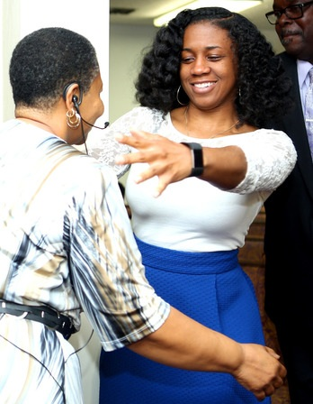
_Plan A Visit — photo (greeting in the sanctuary)_

[CLICK FOR DIRECTIONS](https://goo.gl/maps/QkEcHHD9P462)

3915 Kelley St

Houston, TX 77026

713-635-2501

Administrative office Hours

T-F 8:30 A.M. - 3:00 P.M.

Sunday

8:45 A.M. DEVELOP & DEVELOP Kids

10:00 A.M. Morning Worship Service

Greater E. Children and Youth Services

10:00 A.M.

Children & Youth Services take place in the Gibson - Stewart Fellowship Hall.

All students are required to be checked in and out by parent/legal guardian.

Kingdom Kids' Ministry (Ages 3-12) - 1st & 3rd Sunday

IGNITE Youth Ministry (Middle & High School) - 2nd & 4th Sunday

Tuesday

7:00 P.M. - 8:00 P.M. "Made Alive" Bible Study on "Facebook Live" on the Greater Emmanuel Facebook page & Youtube

GET THE APP

_"Get the App" graphic — text gefwapp to 77977, App Store, QR code_

---

## Events

`https://www.greaterefwc.com/events` · page title: _Greater Emmanuel Family Worship Center | EVENTS_

Upcoming Events

_This page showed a live list of upcoming events from the church's Clover calendar — see **Events calendar** below._

---

## Media

`https://www.greaterefwc.com/media` · page title: _Greater Emmanuel Family Worship Center | MEDIA_

Greater E WORSHIP EXPERIENCES

**Video list (from the old site's media player):**

| Date | Title | Speaker | Link |
|---|---|---|---|
| 12/12/2022 | "Enter"- Dr. Titus B. Stewart Greater E Sunday Morning Worship | Dr. Titus Stewart | [YouTube](https://www.youtube.com/watch?v=zIFEXvxKuk8) |
| 01/18/2023 | Greater Emmanuel Made Alive Biblical Teaching "Mind Your Mind" |  | [YouTube](https://www.youtube.com/watch?v=10yHuIFdqZA) |
| 01/30/2023 | "Guard Your Place"- Greater E Sunday Morning Worship |  | [YouTube](https://www.youtube.com/watch?v=vQJmmWhabvI) |
| 02/20/2023 | The Door Of Expansion-  Greater E Sunday Morning Worship |  | [YouTube](https://www.youtube.com/watch?v=TyqCGkicVmo) |
| 03/06/2023 | I Must Go Back and Tell Him Thank You- Evangelist Debra Jefferson  Greater E Sunday Morning Worship |  | [YouTube](https://www.youtube.com/watch?v=yckgVRfIvWQ) |
| 03/19/2023 | GEFWC " The Anointing"  3/19/2023 |  | [YouTube](https://www.youtube.com/watch?v=uf7lLXIL0YY) |
| 04/03/2023 | Greater E Sunday Morning Worship  " Don't Reject the Answer to Your Future "  April 2, 2023 |  | [YouTube](https://www.youtube.com/watch?v=h-PhFZwmW_Q) |
| 04/09/2023 | GEFWC    Easter Sunday- "The God of Almost"- Bishop Titus Stewart 4/9/23 |  | [YouTube](https://www.youtube.com/watch?v=Repo1CX8lPE) |
| 04/24/2023 | Greater E Sunday Morning Worship  "The Anointing Of The Holy Spirit "  April 23, 2023 |  | [YouTube](https://www.youtube.com/watch?v=LIZnFoAxFoY) |
| 05/15/2023 | Greater E Sunday Morning Worship  "MOM"  May 14, 2023 |  | [YouTube](https://www.youtube.com/watch?v=urTaO-EJZVs) |
| 05/29/2023 | Greater E Sunday Morning Worship - Pentecostal Sunday  May 28, 2023 |  | [YouTube](https://www.youtube.com/watch?v=RN3mtAj6ENY) |
| 06/19/2023 | Greater E Sunday Morning Worship - Forgiveness....The Lesson of Joseph June 18, 2023 |  | [YouTube](https://www.youtube.com/watch?v=-ZW9xk-Rws8) |
| 07/10/2023 | Greater E Sunday Morning Worship -  July 9, 2023 |  | [YouTube](https://www.youtube.com/watch?v=ietGCoQmwBA) |
| 07/31/2023 | Greater E Sunday Morning Worship -  July 30, 2023 |  | [YouTube](https://www.youtube.com/watch?v=FYFutN8_NEw) |
| 08/02/2023 | Greater E Sunday Morning Worship -  KINGDOM SUMMIT AUGUST 01,  2023 |  | [YouTube](https://www.youtube.com/watch?v=sD9lgm0Rq-Y) |
| 08/07/2023 | GEFWC I AM A APOSTOLIC MESSENGER   AUGUST 06,  2023 |  | [YouTube](https://www.youtube.com/watch?v=NalNe7KcQxo) |
| 08/14/2023 | GEFWC I AM A APOSTOLIC MESSENGER PT. II  AUGUST 13,  2023 |  | [YouTube](https://www.youtube.com/watch?v=4vntjoIW5Xg) |
| 08/28/2023 | GEFWC I AM A APOSTOLIC MESSENGER WITH THE KEYS TO THE KINGDOM   AUGUST 27,  2023 |  | [YouTube](https://www.youtube.com/watch?v=B_VPj5VMfUk) |
| 09/18/2023 | Greater E Sunday Morning Worship  September 17, 2023 |  | [YouTube](https://www.youtube.com/watch?v=lH4m6rYhXhw) |
| 09/25/2023 | GEFWC I AM A APOSTOLIC MESSENGER WITH THE KEYS TO THE KINGDOM IV   September 24, 2023 |  | [YouTube](https://www.youtube.com/watch?v=xsESlMrxo_k) |
| 10/23/2023 | GEFWC THE EVIDENCE OF DAMAGE FAITH   October 22, 2023 |  | [YouTube](https://www.youtube.com/watch?v=PYDDHJh2Ps0) |
| 10/30/2023 | GEFWC  October 29, 2023 |  | [YouTube](https://www.youtube.com/watch?v=7qHEqeFpYs4) |
| 11/20/2023 | GEFWC   I Must Conquer This Thing......Offense  November 19, 2023 |  | [YouTube](https://www.youtube.com/watch?v=658_59BhhKE) |
| 12/04/2023 | GEFWC   "JESUS, THE MIRACLE WORKER"    DECEMBER 03,2023 |  | [YouTube](https://www.youtube.com/watch?v=Fd32KLG4wBo) |
| 03/08/2022 | Made Alive Biblical Teaching "The Theology of Suffering PT2" 3/8/2022 | Dr. Titus Stewart | [YouTube](https://www.youtube.com/watch?v=sK0FoNDQQCo) |
| 02/13/2022 | Greater E Church February 13, 2022 Pastor's Appreciation | Suffragan Bishop Billy Wydermyer | [YouTube](https://www.youtube.com/watch?v=XNdnz85oEfU) |
| 12/26/2022 | Greater E. Christmas Service 12/25/22 | Dr. Titus Stewart | [YouTube](https://www.youtube.com/watch?v=84YUhqJFdJ8) |
| 03/20/2022 | Greater E Church "Break through to BREAKTHROUGH!" March 20, 2022 | Evangelist Freda Morrison | [YouTube](https://www.youtube.com/watch?v=MkQwAaSnCQQ) |
| 03/06/2022 | Greater E Church Communion Sunday March 6, 2022 | Dr. Titus Stewart | [YouTube](https://www.youtube.com/watch?v=njWM9BRpYQw) |
| 01/30/2022 | Greater E Church January 30, 2022 | Apostle Moore | [YouTube](https://www.youtube.com/watch?v=3Lkar45BXSc) |
| 03/01/2022 | Made Alive Biblical Teaching "The Theology of Suffering Pt 1" 3/1/2022 | Dr. Titus Stewart | [YouTube](https://www.youtube.com/watch?v=vJbJ2AWS_WQ) |
| 03/22/2022 | Made Alive Biblical Teaching " | Dr. Titus Stewart | [YouTube](https://www.youtube.com/watch?v=IB27sYH5lis) |
| 02/27/2022 | Greater E Church February 27, 2022 | Dr. Titus Stewart | [YouTube](https://www.youtube.com/watch?v=yJOvghb0Huc) |
| 02/20/2022 | Greater E Church February 20, 2022 | Dr. Titus Stewart | [YouTube](https://www.youtube.com/watch?v=CiX_pk1NvBs) |
| 02/06/2022 | Greater E Church February 06, 2022 | Dr. Titus Stewart | [YouTube](https://www.youtube.com/watch?v=7yEzzlsV0cI) |
| 01/30/2022 | Greater E Church 5th Sunday Fire | Praises & Testimonies | [YouTube](https://www.youtube.com/watch?v=bReYxxLDI1M) |

Video descriptions (unique)

We are excited that you are here. Please like, comment, share, and subscribe to our YouTube Channel, Greater Emmanuel Family Worship Center  
  
Your generosity is appreciated and we speak abundant blessings over your life.  
  
Cash App: $GEFWC7  
  
Pushpay: Type GEFWC to the number 77977  
  
We do not own the rights to the music being played during this service.

---

Join Minister Tammy Stewart as she teaches the powerful topic, "Mind Your Mind" for Made Alive Biblical Teaching!

---

Thank you for joining Greater Emmanuel Family Worship Center Made Alive Bible Class. Teaching by Senior Pastor Titus B. Stewart  
Giving Opportunities:  
Cashapp: $GEFWC7  
Text to Give: GEFWC (77977)  
Website: www.greaterefwc.com

---

JOIN US for the second part in the session of "The Theology of Suffering" with Dr. Titus B. Stewart.

---

GEFWC 3915 Kelly Street Houston, TX 77026

---

Join the Dr. Titus Stewart along with the Greater Emmanuel as we explore from a Biblical perspective "The Theology of Suffering"   
“The Lord, the Lord, a God merciful and gracious, slow to anger, and abounding in steadfast love and faithfulness, keeping steadfast love for thousands, forgiving iniquity and transgression and sin, but who will by no means clear the guilty, visiting the iniquity of the fathers on the children and the children’s children, to the third and the fourth generation.”  
  
Exodus 24:6-7 ESV

---

Join Us for Made Alive Biblical Teaching With Dr. Titus Stewart

---

## Media › Children's Church

`https://www.greaterefwc.com/media/childrens-church` · page title: _Greater Emmanuel Family Worship Center | Children's Church_

CHILDREN'S CHURCH

**Video list (from the old site's media player):**

| Date | Title | Speaker | Link |
|---|---|---|---|
| 09/13/2020 | Greater E Kids "The Prodigal Son" |  | [YouTube](https://www.youtube.com/watch?v=Ss2Gn-ggVlg) |
| 08/09/2020 | Greater E Kids Church August 9, 2020 |  | [YouTube](https://www.youtube.com/watch?v=0T6fZgyVb1g) |
| 08/02/2020 | Greater E Kids 3 080220 |  | [YouTube](https://www.youtube.com/watch?v=EzwS37SM7YM) |
| 08/23/2020 | Greater E Kids August 23, 2020 "Elohim" |  | [YouTube](https://www.youtube.com/watch?v=B80vocqgFtQ) |
| 09/06/2020 | Greater E Kids September 6, 2020 |  | [YouTube](https://www.youtube.com/watch?v=zPTeA1wHOmM) |
| 08/30/2020 | Greater E Kids August 30, 2020 " YAHWEH' |  | [YouTube](https://www.youtube.com/watch?v=iLjIk7YS8as) |
| 08/16/2020 | Greater E Kids Church 081620 |  | [YouTube](https://www.youtube.com/watch?v=34X7H164xiY) |
| 07/27/2020 | Greater E Kids Church July 26, 2020 |  | [YouTube](https://www.youtube.com/watch?v=FActmln66EI) |
| 07/19/2020 | Greater E Kids |  | [YouTube](https://www.youtube.com/watch?v=NPZ_l4a561c) |

---

## Media › Views from the Pew

`https://www.greaterefwc.com/media/views-from-the-pew` · page title: _Greater Emmanuel Family Worship Center | Views from the Pew_

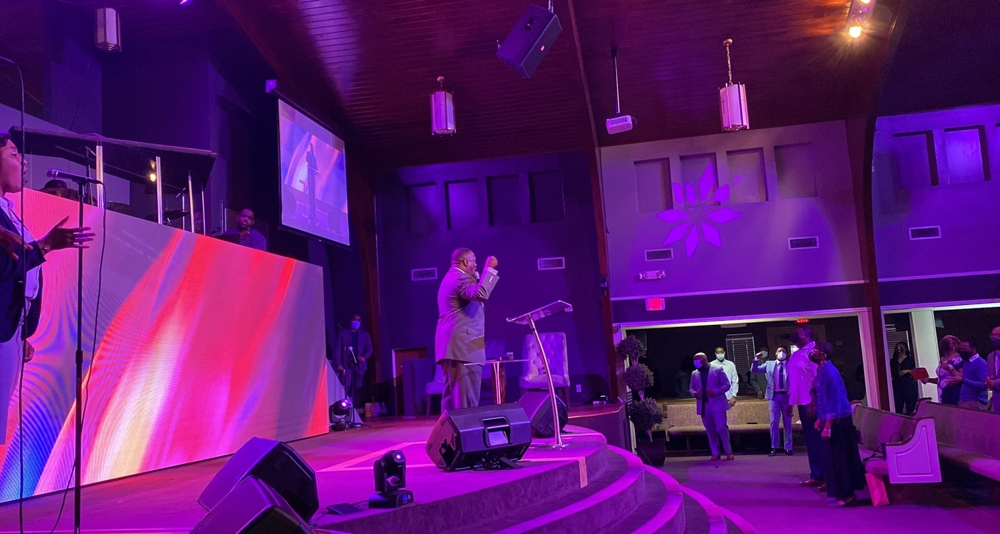
_Views from the Pew — service photo_

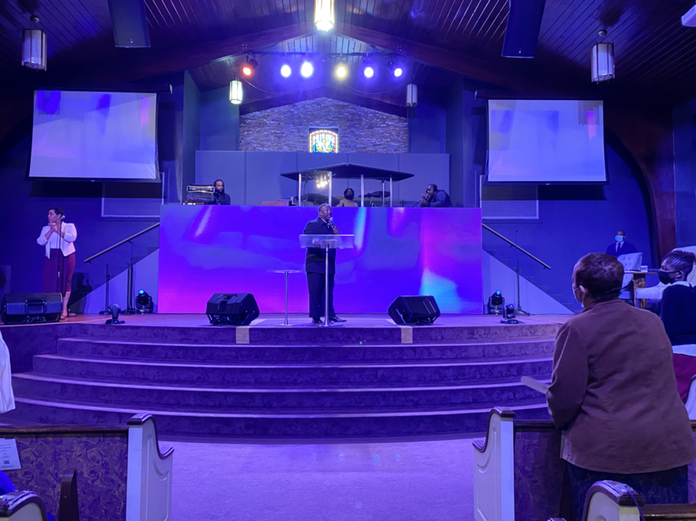
_Views from the Pew — service photo_

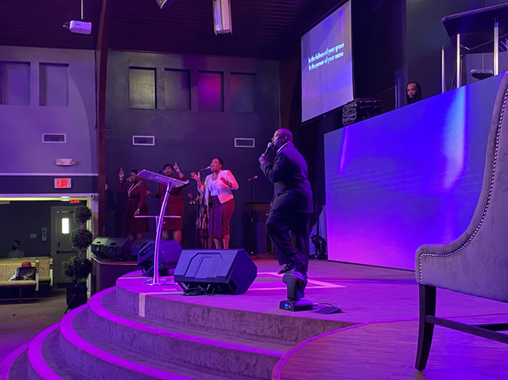
_Views from the Pew — service photo_

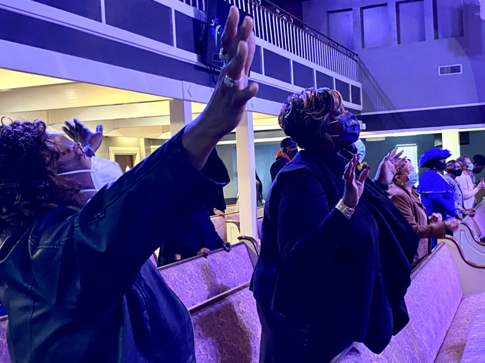
_Views from the Pew — service photo_

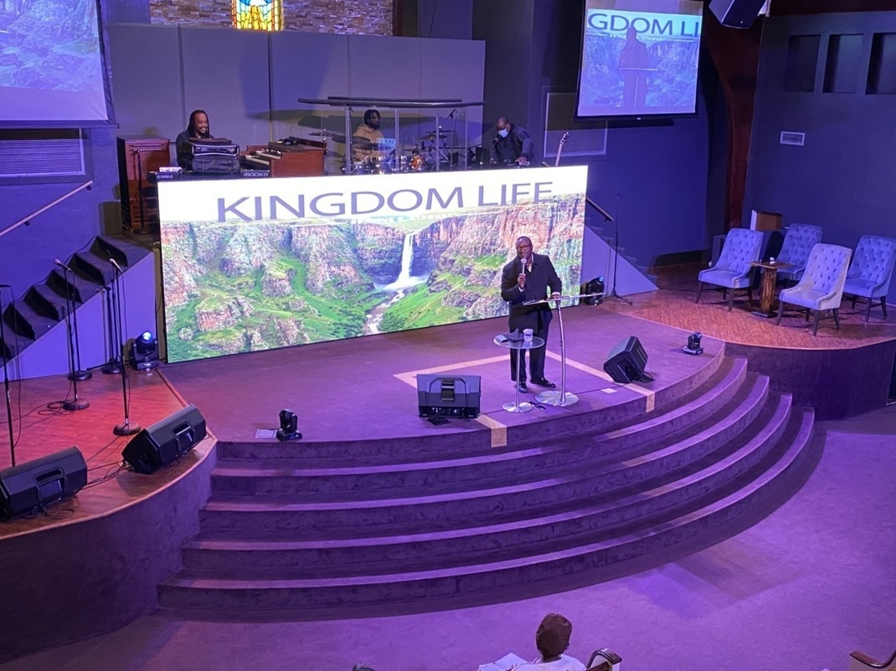
_Views from the Pew — service photo_

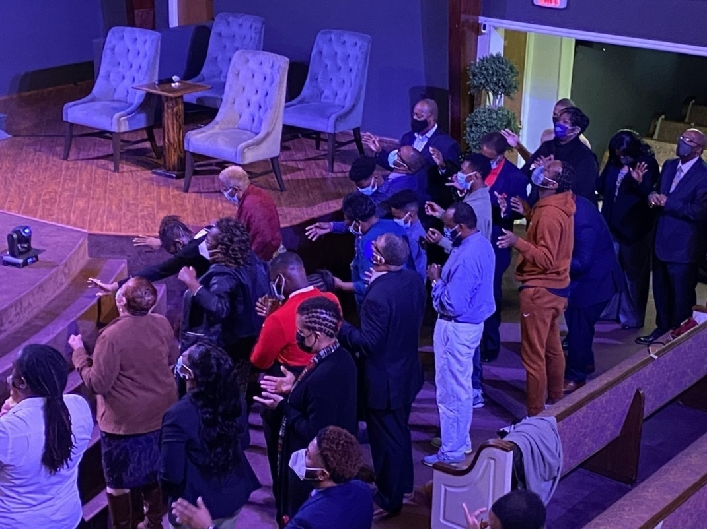
_Views from the Pew — service photo_

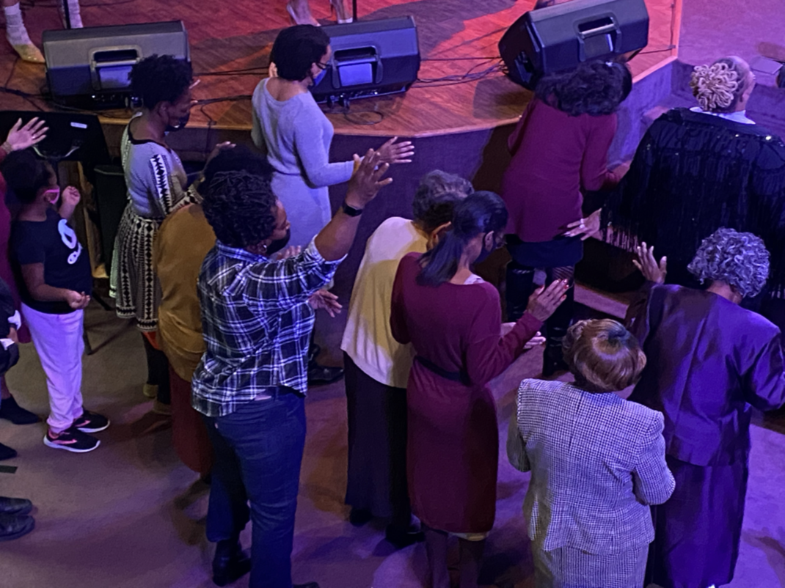
_Views from the Pew — service photo_

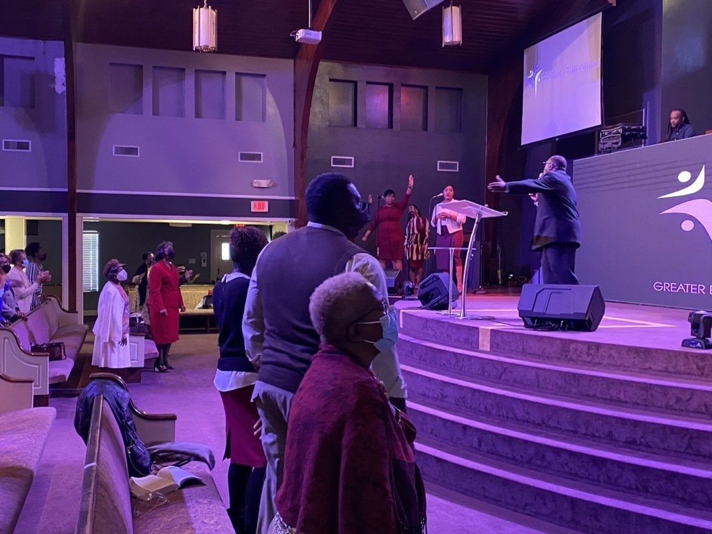
_Views from the Pew — service photo_

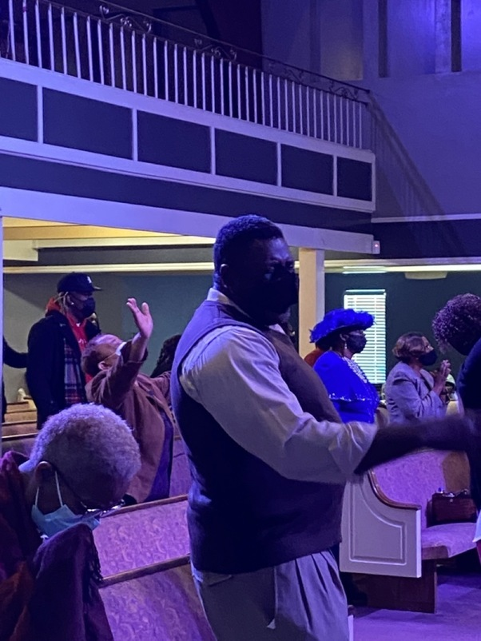
_Views from the Pew — service photo_

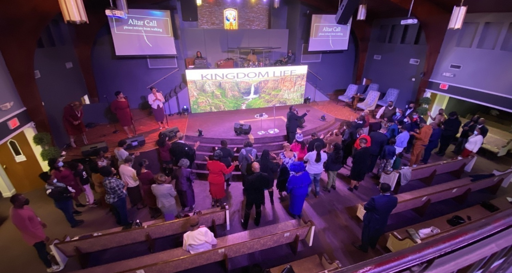
_Views from the Pew — service photo_

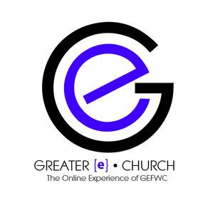
_Views from the Pew — "Greater E Church" logo_

The View from the Pew

Please enjoy the various updates from the services that happen weekly here at Greater E!

---

## Give

`https://www.greaterefwc.com/give` · page title: _Greater Emmanuel Family Worship Center | GIVE_

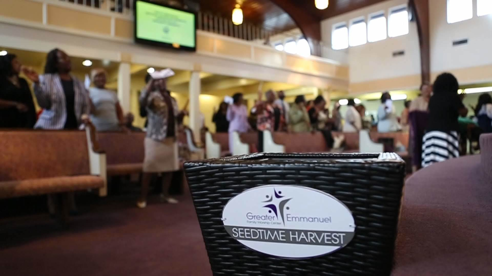
_Give page — background (sanctuary)_

[Click to Give](https://pushpay.com/g/greaterefwc?src=hpp)

10 Bring the whole tithe into the storehouse, that there may be food in my house. Test me in this,” says the Lord Almighty, “and see if I will not throw open the floodgates of heaven and pour out so much blessing that there will not be room enough to store it.

11 I will prevent pests from devouring your crops, and the vines in your fields will not drop their fruit before it is ripe,” says the Lord Almighty.

Malachi 3:10-11

_"Text to Give" graphic — text GEFWC to 77977_

_"Give via the App" graphic — text GEFWCAPP to 77977 to download_

---

## New Member

`https://www.greaterefwc.com/new-member` · page title: _Greater Emmanuel Family Worship Center | NEW MEMBER_

_New Member page — Bishop & Lady Stewart_

Welcome to Greater Emmanuel!

We're so glad that you've decided to be apart of our family!

Please follow these steps to complete the New Member's Orientation:

1. Complete the New Member's Application.

2. Complete the New Member's courses.

3. Follow the "Next Steps"

4. Prepare for Graduation!

---

## New Member › New Member's Application

`https://www.greaterefwc.com/new-member/new-members-application` · page title: _Greater Emmanuel Family Worship Center | New Member's Application_

Please click the link below

[New Member's Form](https://form.jotform.com/221088360971054)

---

## New Member › New Members Courses

`https://www.greaterefwc.com/new-member/new-members-courses` · page title: _Greater Emmanuel Family Worship Center | New Members Courses_

WELCOME TO THE FAMILY!

We are so glad that you have made the decision to be apart of the Greater Emmanuel Family! Below you will find some videos the will help you learn further about our ministry!

**Video list (from the old site's media player):**

| Date | Title | Speaker | Link |
|---|---|---|---|
| 03/03/2022 | Greater Emmanuel New Member's - The History | Dr. Titus Stewart & Lady Tammy Stewart | [MP4 video](https://clovermedia.s3.us-west-2.amazonaws.com/store/fa6fe996-fa0b-46f8-b536-9406160d00a4/97fbdc5237/1080p.mp4) · [MP3 audio](https://clovermedia.s3.us-west-2.amazonaws.com/store/fa6fe996-fa0b-46f8-b536-9406160d00a4/97fbdc5237/audio.mp3) · 24 min |
| 03/03/2022 | Greater Emmanuel New Member's Intro | Dr. Titus Stewart & Lady Tammy Stewart | [MP4 video](https://clovermedia.s3.us-west-2.amazonaws.com/store/fa6fe996-fa0b-46f8-b536-9406160d00a4/1f5d5f6ee6/1080p.mp4) · [MP3 audio](https://clovermedia.s3.us-west-2.amazonaws.com/store/fa6fe996-fa0b-46f8-b536-9406160d00a4/1f5d5f6ee6/audio.mp3) · 4 min |
| 03/03/2022 | Greater Emmanuel New Members Final Session | Evangelist Gloria Jackson | [MP4 video](https://clovermedia.s3.us-west-2.amazonaws.com/store/fa6fe996-fa0b-46f8-b536-9406160d00a4/a6bc8760aa/1080p.mp4) · [MP3 audio](https://clovermedia.s3.us-west-2.amazonaws.com/store/fa6fe996-fa0b-46f8-b536-9406160d00a4/a6bc8760aa/audio.mp3) · 2 min |
| 03/03/2022 | Greater Emmanuel New Members Session 4 | Dr. Titus Stewart | [MP4 video](https://clovermedia.s3.us-west-2.amazonaws.com/store/fa6fe996-fa0b-46f8-b536-9406160d00a4/dd62b05df8/1080p.mp4) · [MP3 audio](https://clovermedia.s3.us-west-2.amazonaws.com/store/fa6fe996-fa0b-46f8-b536-9406160d00a4/dd62b05df8/audio.mp3) · 28 min |
| 03/03/2022 | Greater Emmanuel New Member's Session 3 | Evangelist Gloria Jackson | [MP4 video](https://clovermedia.s3.us-west-2.amazonaws.com/store/fa6fe996-fa0b-46f8-b536-9406160d00a4/369e2894f3/1080p.mp4) · [MP3 audio](https://clovermedia.s3.us-west-2.amazonaws.com/store/fa6fe996-fa0b-46f8-b536-9406160d00a4/369e2894f3/audio.mp3) · 12 min |
| 03/03/2022 | Greater Emmanuel New Member's Session 2 | Dr. Carrie Stewart | [MP4 video](https://clovermedia.s3.us-west-2.amazonaws.com/store/fa6fe996-fa0b-46f8-b536-9406160d00a4/96450b2a15/1080p.mp4) · [MP3 audio](https://clovermedia.s3.us-west-2.amazonaws.com/store/fa6fe996-fa0b-46f8-b536-9406160d00a4/96450b2a15/audio.mp3) · 14 min |
| 03/03/2022 | Greater Emmanuel New Member's Session 1 | Dr. Max Fontus | [MP4 video](https://clovermedia.s3.us-west-2.amazonaws.com/store/fa6fe996-fa0b-46f8-b536-9406160d00a4/e8666fbb62/1080p.mp4) · [MP3 audio](https://clovermedia.s3.us-west-2.amazonaws.com/store/fa6fe996-fa0b-46f8-b536-9406160d00a4/e8666fbb62/audio.mp3) · 13 min |

---

## New Member › Next Steps

`https://www.greaterefwc.com/new-member/next-steps` · page title: _Greater Emmanuel Family Worship Center | Next Steps_

Welcome to the Family!

Now that you've completed the New Member's courses we ask that you would please do the following:

- Take the [New Member's Survey](https://www.surveymonkey.com/r/SHH3JXM)

- Take the [Spiritual Gifts Assessment](https://gifts.churchgrowth.org/spiritual-gifts-survey/) and once completed please send results to [New Member's Team](mailto:NewMembers.GreaterE@gmail.com)

- Get involved in Ministry!

**Video list (from the old site's media player):**

| Date | Title | Speaker | Link |
|---|---|---|---|
| 03/03/2022 | Next Steps |  | [MP4 video](https://clovermedia.s3.us-west-2.amazonaws.com/store/fbfd5079-3db0-4130-b2ff-672b9695a772/ebc24ff2a3/1080p.mp4) · [MP3 audio](https://clovermedia.s3.us-west-2.amazonaws.com/store/fbfd5079-3db0-4130-b2ff-672b9695a772/ebc24ff2a3/audio.mp3) · 0 min |

---

## MMV 1st Annual Cruise (unfinished page)

`https://www.greaterefwc.com/mmv-1st-annual-cruise` · page title: _Greater Emmanuel Family Worship Center | MMV 1st Annual Cruise_

_The page only contained Clover's placeholder text — it was never filled in:_

Section Title

Type the content for this section here. This is just example text to show you what it will look like when you enter text content into this section. Your unique, authentic, and appropriate text will be filled into this section. Once you click into this section, you will see the filler text disappear, and you can begin typing your real content. We’ve simply put in filler text in this area. No need to get caught up in the actual content of this body text, we just typed a bunch of meaningless sentences. If you get anything from this text, please understand that this is just example text to give you a feeling for what your real text might look like.

---

## Site footer (on every page)

Greater Emmanuel Family Worship Center

3915 Kelley St., Houston, TX 77026

[church websites by clover](https://www.cloversites.com)

---

## Events calendar

The old Events page and home page pulled from Clover's calendar ("Almanac"). The new site's `/api/events` reads the same calendar, so staff can keep adding events in Clover for now.

- **JSON feed:** `https://almanac.cloversites.com/v1/calendars/greateremmanuelfamilyworshipcenter/events?filter[start_date]=YYYY-MM-DD&filter[end_date]=YYYY-MM-DD`
- **Subscribe link (iCal):** `webcal://almanac.cloversites.com/greateremmanuelfamilyworshipcenter/ics.ics` — the old site's "Subscribe to Calendar" button
- **Timezone:** America/Chicago

**Upcoming at capture time (Nov 2026 – Jan 2027):** DEVELOP – Christian Education (Sundays 8:45–9:45 AM), Morning Worship Service (Sundays 10:00 AM–12:30 PM), Made Alive Bible Study – Facebook Live (Tuesdays 7:00–8:00 PM, links to facebook.com/gefwc). Nothing else was scheduled.

### Full calendar history (from the iCal export, 2018 onward)

**Recurring series**

| Event | Starts | Time | Repeat rule | Description |
|---|---|---|---|---|
| Morning Worship Experience! | 0202-08-01 | 10:00 AM | `FREQ=WEEKLY;UNTIL=20211127;INTERVAL=4;BYDAY=SU` | Join us for our Worship Experience! |
| Made Alive - Weekly Bible Study | 2018-06-12 | 7:00 PM | `FREQ=WEEKLY;UNTIL=20180613;INTERVAL=1;BYDAY=TU` | Join us for "Made Alive."  Our weekly bible study. |
| Made Alive - Weekly Bible Study | 2018-06-19 | 7:00 PM | `FREQ=WEEKLY;UNTIL=20180620;INTERVAL=1;BYDAY=TU` | Join us for "Made Alive."  Our weekly bible study. |
| Made Alive - Weekly Bible Study | 2018-06-26 | 7:00 PM | `FREQ=WEEKLY;UNTIL=20180627;INTERVAL=1;BYDAY=TU` | Join us for "Made Alive."  Our weekly bible study. |
| Boot Camp Saturday | 2018-07-07 | 9:00 AM | `FREQ=WEEKLY;UNTIL=20210313;INTERVAL=2;BYDAY=SA` | Join us  as we embark on a new fitness journey! Saturday July 7th at 11:00am-12:00 pm in the GEFWC parking lot.  This is |
| Ministerial Academy | 2018-07-08 | 8:45 AM | `FREQ=WEEKLY;UNTIL=20180902;INTERVAL=1;BYDAY=SU` | A weekly course designed to develop, educate and train individuals interested in ministering. |
| Made Alive - Weekly Bible Study | 2018-07-10 | 7:00 PM | `FREQ=WEEKLY;UNTIL=20190605;INTERVAL=1;BYDAY=TU` | Join us for "Made Alive."  Our weekly bible study. |
| Discipleship Course Phase One | 2018-08-05 | 8:45 AM | `FREQ=WEEKLY;UNTIL=20180902;INTERVAL=1;BYDAY=SU` | Discipleship Course Phase One will be held every Sunday at 8:45-9:45 am starting on August 5th. |
| Children's Church | 2018-08-05 | 10:00 AM | `FREQ=WEEKLY;UNTIL=20210314;INTERVAL=2;BYDAY=SU` | GEFWC: Children's Church  Join our friendly staff, in making learning about Jesus fun! For Ages 3-12, on the First and T |
| Marriage Ministry Webinar | 2018-08-06 | 8:00 PM | `FREQ=WEEKLY;UNTIL=20180903;INTERVAL=1;BYDAY=MO` | Will focus on renewing thinking, intimacy and commitment. |
| Teen Church | 2018-08-12 | 10:00 AM | `FREQ=WEEKLY;UNTIL=20210307;INTERVAL=2;BYDAY=SU` | GEFWC Identified: Teen Church  Calling all teens between the ages of 13-18!  Every Second Sunday of the month in the Fel |
| Credit Restoration Phase One | 2018-08-15 | 6:15 PM | `FREQ=WEEKLY;UNTIL=20180905;INTERVAL=1;BYDAY=WE` | Credit Restoration classes will be held on Wednesdays Starting August 15th, 22nd and the 29th. 6:15-7:15 pm Cost: Bishop |
| Made Alive Biblical Teaching - Facebook Live & Youtube | 2021-03-02 | 7:00 PM | `FREQ=WEEKLY;UNTIL=20221010;INTERVAL=1;BYDAY=TU` | Virtual Bible Study |
| Spiritual Gifts Teaching Session | 2021-10-17 | 8:45 AM | `FREQ=WEEKLY;UNTIL=20211031;INTERVAL=1;BYDAY=SU` | Spiritual Gifts Teaching Session |
| Greater E Ministerial Academy | 2021-11-03 | 7:00 PM | `FREQ=WEEKLY;UNTIL=20211117;INTERVAL=1;BYDAY=WE` | Virtual Session via Zoom. Details Forthcoming |
| Life Class: Kingdom Finance | 2021-11-04 | 7:45 PM | `FREQ=WEEKLY;UNTIL=20211118;INTERVAL=1;BYDAY=TH` | https://kingdom-finance-life-classes-greater-emmanuel-family-worship.pushpayevents.com/ |
| Kingdom Fitness | 2021-11-06 | 8:00 AM | `FREQ=WEEKLY;UNTIL=20211120;INTERVAL=1;BYDAY=SA` |  |
| Greater E Children's Church | 2021-11-07 | 9:45 AM | `FREQ=WEEKLY;UNTIL=20211121;INTERVAL=2;BYDAY=SU` | Children's church for children and Youth ages 5-12. Registration is required. |
| Marriage Blaze - For Married Couples Only | 2021-11-08 | 7:45 PM | `FREQ=WEEKLY;UNTIL=20211115;INTERVAL=1;BYDAY=MO` | Virtual Session with Dr. Titus & Lady Tammy Stewart |
| Morning Worship Experience! | 2021-11-28 | 10:00 AM | `FREQ=WEEKLY;UNTIL=20221001;INTERVAL=1;BYDAY=SU` | Join us for our Worship Experience! |
| Armor of God Virtual Bible Study | 2022-03-09 | 7:00 PM | `FREQ=WEEKLY;UNTIL=20220323;INTERVAL=1;BYDAY=WE` | Women With Purpose get ready for the Zoom Bible study this Wednesday, March 2, 2022 at 7:15 pm (cst).    If you would li |
| Armor of God Virtual Bible Study | 2022-03-09 | 7:00 PM | `FREQ=WEEKLY;UNTIL=20220427;INTERVAL=1;BYDAY=WE` | Women With Purpose get ready for the Zoom Bible study this Wednesday, March 2, 2022 at 7:15 pm (cst).    If you would li |
| Armor of God Virtual Bible Study | 2022-03-09 | 7:00 PM | `FREQ=WEEKLY;UNTIL=20220427;INTERVAL=1;BYDAY=WE` | Women With Purpose get ready for the Zoom Bible study this Wednesday, March 2, 2022 at 7:15 pm (cst).    If you would li |
| Teen Service | 2022-03-13 |  | `FREQ=DAILY;UNTIL=20220327` | Calling all High School Students for Teen ministry |
| Morning Worship Experience! | 2022-10-02 | 10:00 AM | `FREQ=WEEKLY;UNTIL=20221008;INTERVAL=1;BYDAY=SU` | Join us for our Worship Experience! |
| Morning Worship Experience! | 2022-10-09 | 10:00 AM | `FREQ=WEEKLY;INTERVAL=1;BYDAY=SU` | Join us for our Worship Experience! |
| Morning Worship Experience! | 2022-10-09 | 10:00 AM | `FREQ=WEEKLY;INTERVAL=1;BYDAY=SU` | Join us for our Worship Experience! |
| Made Alive Biblical Teaching - Facebook Live & Youtube | 2022-10-11 | 7:00 PM | `FREQ=WEEKLY;INTERVAL=1;BYDAY=TU` | Virtual Bible Study |
| Fall Session of Texas State Council of the Pentecostal Assemblies of the World\, Inc. | 2022-10-12 | 7:00 PM | `FREQ=DAILY;UNTIL=20221014` |  |
| Women With Purpose Prayer | 2023-01-27 | 5:30 AM | `FREQ=WEEKLY;UNTIL=20231214;INTERVAL=1;BYDAY=FR` | Fridays at 5:30 am (cst)  Women With Purpose  Prayer Line  Dial-In #: (717) 275-8940  Access Code: 567-4306 |
| Seek His Face\, Faith & Miracle  Prayer Line | 2023-02-15 | 6:00 AM | `FREQ=WEEKLY;INTERVAL=1;BYDAY=WE` | Wednesdays at 6:00 am (cst)  Seek His Face, Faith & Miracle  Prayer Line  Dial-In #: (717) 275-8940  Access Code: 673-99 |
| Greater E's "Jesus" Sermon Series! | 2023-12-10 | 10:00 AM | `FREQ=WEEKLY;UNTIL=20231231;INTERVAL=1;BYDAY=SU` |  |
| Women With Purpose Prayer | 2023-12-15 | 5:30 AM | `FREQ=WEEKLY;UNTIL=20231222;INTERVAL=1;BYDAY=FR` | Fridays at 5:30 am (cst)  Women With Purpose  Prayer Line  Dial-In #: (717) 275-8940  Access Code: 567-4306 |
| Made Alive Biblical Teaching | 2024-06-11 | 7:00 PM | `FREQ=WEEKLY;INTERVAL=1;BYDAY=TU` |  |
| Worship Service | 2024-06-16 | 10:00 AM | `FREQ=WEEKLY;UNTIL=20250531;INTERVAL=1;BYDAY=SU` |  |
| Develop Christian Education | 2024-06-23 | 8:45 AM | `FREQ=WEEKLY;UNTIL=20250531;INTERVAL=1;BYDAY=SU` |  |
| Develop Christian Education | 2025-06-01 | 8:45 AM | `FREQ=WEEKLY;UNTIL=20250607;INTERVAL=1;BYDAY=SU` |  |
| Worship Service | 2025-06-01 | 10:00 AM | `FREQ=WEEKLY;UNTIL=20250621;INTERVAL=1;BYDAY=SU` |  |
| DEVELOP Christian Education | 2025-06-08 | 8:45 AM | `FREQ=WEEKLY;UNTIL=20250621;INTERVAL=1;BYDAY=SU` |  |
| Greater E. Ministerial Academy | 2025-06-12 | 7:00 PM | `FREQ=DAILY;UNTIL=20250614;INTERVAL=1` |  |
| DEVELOP Christian Education | 2025-06-22 | 8:45 AM | `FREQ=WEEKLY;UNTIL=20260103;INTERVAL=1;BYDAY=SU` |  |
| Morning Worship Experience Service | 2025-06-22 | 10:00 AM | `FREQ=WEEKLY;UNTIL=20251229;INTERVAL=1;BYDAY=SU` |  |
| Morning Worship Service | 2025-06-22 | 10:00 AM | `FREQ=WEEKLY;UNTIL=20251227;INTERVAL=1;BYDAY=SU` |  |
| Vacation Bible School "Building On God's Model" | 2025-06-24 | 7:00 PM | `FREQ=DAILY;UNTIL=20250628;INTERVAL=1` |  |
| Kingdom Kids' Church | 2025-07-06 | 10:00 AM | `FREQ=MONTHLY;UNTIL=20251231;INTERVAL=1;BYDAY=1SU` |  |
| Kingdom Kids' Church | 2025-07-20 | 10:00 AM | `FREQ=MONTHLY;UNTIL=20251228;INTERVAL=1;BYDAY=3SU` |  |
| Morning Worship Service | 2025-12-28 | 10:00 AM | `FREQ=WEEKLY;UNTIL=20270103;INTERVAL=1;BYDAY=SU` | Join us every Sunday for our Sunday Morning Worship Experience! Come Worship with us were Love Lives Here! We look forwa |
| Made Alive Bible Study - Facebook Live | 2026-01-13 | 7:00 PM | `FREQ=WEEKLY;INTERVAL=1;BYDAY=TU` | Bible Study via Facebook Live |
| DEVELOP - Christian Education | 2026-01-18 | 8:45 AM | `FREQ=WEEKLY;INTERVAL=1;BYDAY=SU` | Christian Education - DEVELOP Classes For Everyone! Come Grow Into More! |

**One-off and individually-entered events**

| First date | Last date | Times | Event | Time | Description |
|---|---|---|---|---|---|
| 2018-06-12 | 2018-08-28 | 5 | Made Alive - Weekly Bible Study | 7:00 PM | Join us for "Made Alive."  Our weekly bible study. |
| 2018-06-17 | 2018-06-17 | 2 | FATHER'S DAY SERVICE | 10:00 AM | Join Women With Purpose as we celebrate the GEFWC Father's on their special day! |
| 2018-06-23 | 2018-09-01 | 4 | Boot Camp Saturday | 11:00 AM | Join us on the campus of GEFWC for Boot Camp Saturday.  The event is free and open to the public.  Please bring bottled water and a towel. |
| 2018-07-02 | 2018-07-02 | 2 | Church Vacation |  | There are no events or meetings scheduled for this week.  Please take this time to enjoy with your families.  We will resume Service on Sunday, July 8th @ 10am. |
| 2018-07-02 |  | 1 | TBSM Golf Tournament | 8:00 AM | This year, T. B. Stewart Ministries will host its 2nd Annual Golf Tournament benefiting St. Jude Children’s Hospital to be the HOPE for many children’s future. … |
| 2018-07-06 |  | 1 | Matters of the Heart Soul Session | 7:00 PM |  Join the Youth and Young Adult ministry as we dive into the matters of the heart with our special guest therapist Dr. Daisy McCloud. This event is open to all … |
| 2018-07-18 |  | 1 | Vacation Bible School | 6:30 PM | Join us for Vacation Bible School on July 18th, 19th, and the 20th.  6:30 p.m. - 8:00 p.m. nightly  This year's theme is "Forgoing the Process"  Fun for the ent… |
| 2018-07-28 | 2018-07-28 | 2 | MMOV Rap Session | 9:55 AM | An opportunity for the Mighty Men of Valor to discuss issues men in society face. |
| 2018-07-29 | 2018-07-29 | 2 | First Lady Speaking Engagement | 4:00 PM | Join First Lady as she will be ministering at New Covenant Christian Church on  Sunday, July 29th at 4 pm.  click the link below for directions. You can also ac… |
| 2018-07-31 | 2018-07-31 | 2 | Vision Progression Meeting | 7:00 PM | The Vision Shall Come To pass |
| 2018-08-05 | 2018-08-26 | 4 | Ministerial Academy | 8:45 AM | A weekly course designed to develop, educate and train individuals interested in ministering. |
| 2018-08-05 | 2018-08-26 | 4 | Discipleship Course Phase One | 8:45 AM | Discipleship Course Phase One will be held every Sunday at 8:45-9:45 am starting on August 5th. |
| 2018-08-05 | 2018-08-19 | 2 | Children's Church | 10:00 AM | GEFWC: Children's Church  Join our friendly staff, in making learning about Jesus fun! For Ages 3-12, on the First and Third Sunday of the month.  June 3rd is t… |
| 2018-08-06 | 2018-08-27 | 4 | Marriage Ministry Webinar | 8:00 PM | Will focus on renewing thinking, intimacy and commitment. |
| 2018-08-12 | 2018-08-26 | 2 | Teen Church | 10:00 AM | GEFWC Identified: Teen Church  Calling all teens between the ages of 13-18!  Every Second Sunday of the month in the Fellowship Hall at 10:00 am. |
| 2018-08-15 | 2018-08-29 | 3 | Credit Restoration Phase One | 6:15 PM | Credit Restoration classes will be held on Wednesdays Starting August 15th, 22nd and the 29th. 6:15-7:15 pm Cost: Bishop Stewart will be offering a $500 class f… |
| 2018-08-24 | 2018-08-24 | 2 | Marriage Ministry: Reignite The Fire |  | MM Presents: Reignite The Fire  The Marriage Ministry would like to invite all married couples to a stimulating two day session focusing on reigniting the fire … |
| 2018-08-25 |  | 1 | SSGU: Escape Room | 4:30 PM | SSGU Presents...The Escape Room  Singles Serving God Until ministry would like you to join them as they try to escape in time! Join us for fun, loving fellowshi… |
| 2018-09-02 | 2018-09-02 | 2 | Women With Purpose Girl's Trip | 9:00 AM | The ladies of WWP are inviting you to join them to encounter "The Cross At Kerriville". Experience angelic presence, dining, shopping, prophetic miracles and he… |
| 2018-11-19 |  | 1 | Sharing Our Heart with the Community | 6:00 PM | Sharing Our Heart with the Community “Sharing Our Heart with the Community”, in collaboration with community partners, the Greater Emmanuel Family Worship Cente… |
| 2020-02-09 |  | 1 | Bishop Titus B. Stewart |  | Celebrating the LIFE and Pastoral Anniversary of Bishop Titus B. Stewart! |
| 2021-02-14 |  | 1 | RE-Gathering of the Family | 10:00 AM | https://the-re-gathering-of-the-family-greater-emmanuel-family-worship.pushpayevents.com/booking/attendees/new |
| 2021-03-07 |  | 1 | In-Person Morning Worship Service | 10:00 AM | Register here for our in-person worship service! |
| 2021-03-21 |  | 1 | In Person Service | 10:00 AM | Meet us for in person service! Please be sure to register online! |
| 2021-04-04 |  | 1 | Resurrection Sunday Celebration | 10:00 AM | Join us for our Resurrection Celebration! |
| 2021-06-10 | 2021-06-17 | 2 | Financial Freedom Course | 7:30 PM | Greater Emmanuel Family Worship Center is inviting you to a scheduled Zoom Sessions.  Topic: "How To Discover Financial Freedom Using Kingdom Principles"  Facil… |
| 2021-06-18 | 2021-06-18 | 2 | Taste & Teach | 7:00 PM | Join  Greater E's Mighty Men of Valor for a night of great food, fellowship and empowerment with our pastor, Dr. Titus Stewart. This event is open to all men! |
| 2021-08-01 |  | 1 | Honk For Jesus! | 12:30 PM | Join us as we reach out to the Houston community as we challenge them to Honk their horns for Jesus! |
| 2021-09-24 |  | 1 | 4th Friday Fellowship | 7:00 PM |  |
| 2021-09-24 |  | 1 | 4th Friday Fellowship - Game Night | 7:30 PM |  |
| 2021-09-30 |  | 1 | FAMILY GAME NIGHT | 7:00 PM | JOIN GREATER E FAMILIES AS WE ENJOY GAME NIGHT WITH THE HOUSTON ASTROS |
| 2021-10-03 |  | 1 | Change a Life Sunday | 10:00 AM |  |
| 2021-10-11 | 2021-10-25 | 3 | Marriage Blaze - For Married Couples Only | 7:45 PM |  |
| 2021-10-22 |  | 1 | College & Young Professionals | 7:30 PM | Axe Throwing with College and Young Professionals |
| 2021-10-29 | 2021-12-10 | 3 | Inspire Single's Ministry | 7:45 PM |  |
| 2021-10-31 |  | 1 | Greater E Ministerial Academy | 8:45 AM | Training Session for Ministers |
| 2021-11-14 |  | 1 | Greater E Teen Church | 9:45 AM |  |
| 2021-11-28 |  | 1 | Morning Worship Experience! | 10:00 AM | Join us for our Worship Experience! |
| 2022-01-01 |  | 1 | 21 Days OF CONSECRATION | 12:00 AM |  |
| 2022-01-25 |  | 1 | Prayer Revival | 7:00 PM | Join us for the Prayer Revival Virtually!  Join Zoom Meeting  Meeting ID: 867 5905 9281 Passcode: 940755 Phone: (346) 248-7799 |
| 2022-01-30 | 2022-01-30 | 2 | 5th Sunday Service | 5:00 PM | Fifth Sunday "Live @ 5PM" Service |
| 2022-03-04 | 2022-03-04 | 2 | College Readiness Seminar | 10:00 AM | Calling All Students ~ Grades 9th – 12th, GEFWC is hosting a College Readiness Workshop designed with you in mind.  Saturdays: Feb. 19th, March 5th, April 2nd &… |
| 2022-03-11 |  | 1 | Foodie's Small Group | 7:00 PM | Meet our Foodie's Small Group as we go to  Treebeards 9655 Katy Fwy Ste 3120 Houston, TX 77024 |
| 2022-03-13 |  | 1 | Teen Service | 10:00 AM | Calling all High School Students for Teen ministry |
| 2022-03-18 | 2022-03-18 | 2 | Spring Break-Through! | 9:00 AM | Greater Emmanuel Student Ministries is excited about Spring Break-Through 2022! Our Theme Is "...And SUDDENLY!" Acts 16:26! Our guest speaker is Evangelist Fred… |
| 2022-03-29 | 2022-04-19 | 2 | Made Alive Biblical Teaching - Facebook Live & Youtube | 7:00 PM | Virtual Bible Study |
| 2022-04-17 |  | 1 | Resurrection Service | 10:00 AM |  |
| 2022-04-23 | 2022-04-23 | 2 | Communtiy Day | 9:00 AM |  |
| 2022-04-24 |  | 1 | The Ascension "VISION SUNDAY" | 10:00 AM | Join us for Vision Sunday with Dr. Titus Stewart! |
| 2022-07-27 |  | 1 | GE Student Ministries Six Flags Trip |  |  |
| 2022-10-12 |  | 1 | Fall Session of Texas State Council of the Pentecostal Assemblies of the World\, Inc. | 7:00 PM |  |
| 2022-10-15 | 2022-10-15 | 2 | Texas State Council Young People's Session | 9:00 AM |  |
| 2023-01-29 |  | 1 | Mission Sunday Service with Guest Speaker Lady Tammy Stewart | 12:00 PM | Join Lady Tammy Stewart as she will be the special guest for the Mission Sunday Service on Sunday, January 29, 2023 at 12 pm.  6551 Heffernan St. * Houston, TX … |
| 2023-02-04 |  | 1 | Bay Area District Fellowship | 11:00 AM |  |
| 2023-02-05 |  | 1 | Christian Education for Everyone | 8:45 AM | New Christian Education for Everyone  Starting February 5, 2023 at 8:45 am every Sunday Morning!  Are You Ready!  LET'S GROW INTO MORE TOGETHER!!! |
| 2023-02-18 |  | 1 | Run\, Daughter\, Run Women Conference 2023 | 9:00 AM | Make plans to join Lady Tammy Stewart as she ministers on Saturday, February 18th at the 9 am service for the Run, Daughter, Run Women Conference 2023  "Built T… |
| 2023-08-27 |  | 1 | Skate Party | 2:00 PM |  |
| 2023-12-31 | 2023-12-31 | 2 | Greater Emmanuel's End of the Year Service | 5:00 PM | Join us for our End of the Year service with Bishop Paul Landrew! You don't want to miss this! |
| 2024-01-07 |  | 1 | Greater Emmanuel's Ascension Sunday 2024 | 10:00 AM |  |
| 2024-06-16 |  | 1 | Dad's & Donuts | 9:15 AM |  |
| 2024-06-23 |  | 1 | Ignite Youth Ministry Sunday | 10:00 AM |  |
| 2024-06-30 |  | 1 | Develop's Got Talent | 8:30 AM |  |
| 2024-09-14 | 2024-09-14 | 2 | "Determined to Win" Women's Brunch! | 11:00 AM | Join Us for the GEFWC Women With Purpose Annual "Determined to Win" Women's Brunch! We are thrilled to invite you to a powerful and inspiring brunch on Saturday… |
| 2024-11-10 |  | 1 | 67th Church Anniversary Service | 10:00 AM |  |
| 2025-02-08 |  | 1 | (Greater E Legacy Gala) Bishop's 25 Years of Pastoral Anniversary & 55 Years of Life | 6:30 PM |  |
| 2025-06-08 |  | 1 | Pentecost Sunday & Communion Service | 10:00 AM |  |
| 2025-06-12 | 2025-06-13 | 2 | Greater E. Ministerial Academy | 7:00 PM |  |
| 2025-06-15 |  | 1 | (Postponed) DEVELOP Christian Education | 8:45 AM |  |
| 2025-06-15 |  | 1 | Worship Service - Father's Day | 10:00 AM |  |
| 2025-06-21 | 2025-06-21 | 2 | Mighty Men of Valor - Let's Talk | 10:00 AM | Calling ALL Men! Join Bishop Titus B. Stewart on Saturday, June 21st at 10:00 am in the Gibson-Stewart Fellowship Hall. Let's Talk! - Real Men, Real Heart, Real… |
| 2025-06-22 |  | 1 | DEVELOP Christian Education | 8:45 AM |  |
| 2025-06-24 | 2025-06-27 | 3 | Vacation Bible School "Building On God's Model" | 7:00 PM |  |
| 2025-06-26 |  | 1 | VBS Family Night - Marcus D. Wiley (Guest Comedian) | 7:00 PM |  |
| 2025-06-30 | 2025-06-30 | 2 | 9th Annual Charity Golf Tournament | 8:00 AM |  |
| 2025-07-25 |  | 1 | IGNITE 3 on 3  Basketball Tournament | 1:30 PM | Greater E’s IGNITE is excited to announce that our 3-on-3 basketball tournament is back! Open to everyone aged 13 and up.  If you are interested, you can regist… |
| 2025-07-27 |  | 1 | Youth Sunday Worship Service | 10:00 AM | Ignite Sunday Takeover happening on July 27th, 2025. We’re coming back bigger and better than ever!  Be sure to look out for our new Ignite shirts that will be … |
| 2025-07-27 | 2025-07-27 | 2 | Singles Ministry - Ice Breaker Session | 12:00 PM | Hey All Singles, Join us on Sunday, July 27th immediately after Sunday Morning in the Gibson-Stewart Fellowship Hall for an afternoon of fellowship. Refreshment… |
| 2025-08-30 |  | 1 | 4th Annual WWP Determined To Win Brunch | 11:00 AM | Join our Host, Lady Tammy Stewart and the Women With Purpose Ministry, along with Guest Speaker: Dr. Faith Wokoma, Mistress of Ceremony: Lady Britney Jones & Pr… |
| 2025-09-02 |  | 1 | Vision & Kingdom Future Night | 7:00 PM |  |
| 2026-01-06 |  | 1 | Tuesday Night LIVE - Solemn Assembly | 7:00 PM | Join us in person on Tuesday, January 6, 2026 at 7pm for our Tuesday Night Solemn Assembly LIVE with Bishop Titus B. Stewart. See You There! |
| 2026-01-18 |  | 1 | Singles Ministry - Vision Board Brunch | 12:00 PM | Join us for a time of vision, fellowship and brunch as we create vision boards for a purposeful New Year! Vision Board supplies provided. Brunch will be service… |
| 2026-01-25 |  | 1 | Postponed DEVELOP - Christian Education | 8:45 AM | Due to Inclement Weather, Christian Education - DEVELOP is Postponed. |
| 2026-01-25 |  | 1 | Closure Notice: Morning Worship Service | 10:00 AM | Due to Inclement Weather, We will not be worshipping in person this Sunday, 1/25/2026 to ensure the safety of our congregants and guests.  Join us online for ou… |
| 2026-02-03 |  | 1 | Tuesday Night IMPACT Live | 7:00 PM | Join us for our in-person Tuesday Night IMPACT Live Bible Class.  |
| 2026-02-06 |  | 1 | WWP Galentine's Girls Night | 7:30 PM | *You must Register to Attend* Women With Purpose is excited to announce our WWP Girls Night – Galentine’s Edition! This will be a beautiful night of fun, food, … |
| 2026-02-06 |  | 1 | SOLD OUT ~ WWP Galentine's Girls Night | 7:30 PM | SOLD OUT! We are full to Capacity *You Must Have Registered To Attend* Women With Purpose is excited to announce our WWP Girls Night – Galentine’s Edition! This… |
| 2026-02-08 |  | 1 | POSTPONED ~ DEVELOP Christian Education | 8:45 AM | Our Christian Education - DEVELOP is POSTPONED on February 8, 2026.  DEVELOP will resume the following Sunday, February 15, 2026 at 8:45 am. |
| 2026-02-08 |  | 1 | 26th Pastoral Anniversary Celebration | 10:00 AM | Join us in Honoring the Journey & Celebrating the Servants for the 26th Pastoral Anniversary of Dr. Titus B. Stewart and Lady Tammy Stewart. |
| 2026-02-13 |  | 1 | When Love Speaks: Abide - Single Ministry | 7:00 PM | Calling All Singles to Join us in collaboration with Proclaim Ministry, for an evening of Growth, Connection & Support.  Heartfelt Discussions Community & Suppo… |
| 2026-02-13 | 2026-02-13 | 2 | Marriage Ministry Valentine's Dinner | 7:30 PM | All Greater Emmanuel Family Worship Center Married Couples, Join us on February 13, 2026 at 7:30 pm (cst) for our Marriage Ministry Valentine's Dinner. $75 per … |
| 2026-02-22 |  | 1 | Black History Month Morning Worship Service | 10:00 AM | Join us Sunday, February 22nd, as we celebrate Black History Month! We invite all church members to wear traditional African attire to honor and embrace our ric… |
| 2026-02-28 |  | 1 | Joshua Generation - Bingo at Park Manor | 10:00 AM | You are invited to join The Joshua Generation for "Bingo at Park Manor," an event designed to bring together the seniors of Park Manor Nursing Facility for a mo… |
| 2026-05-18 | 2026-05-18 | 2 | MMV 1st Annual Cruise | 9:00 AM | ATTENTION ALL BROTHERS 21 AND UP!! Greater Emmanuel Family Worship Center's Mighty Men of Valor invite you to our 1st Annual Men's Ministry Cruise, May 18 - 23,… |

---

## Image index

| File | What it is | Original URL |
|---|---|---|
| [01-2548cc43.jpg](old-website/images/01-2548cc43.jpg) | Home page animated background — congregation in worship (still frame; original is an animated GIF) | [link](https://s3.amazonaws.com/media.cloversites.com/f5/f5d043e9-b9dc-44b2-af8a-526890433993/backgrounds/2548cc43-7c52-4083-9516-47be744e0639.gif) |
| [02-387b59d8.png](old-website/images/02-387b59d8.png) | Home slideshow — Greater Emmanuel logo slide | [link](https://s3.amazonaws.com/media.cloversites.com/f5/f5d043e9-b9dc-44b2-af8a-526890433993/gallery/slides/387b59d8-4988-4d8c-908f-5931f3db8abb.png) |
| [03-10b2b367.png](old-website/images/03-10b2b367.png) | Home slideshow — "Our Mission" slide | [link](https://s3.amazonaws.com/media.cloversites.com/f5/f5d043e9-b9dc-44b2-af8a-526890433993/gallery/slides/10b2b367-7539-4731-82b0-b7f5e43245ac.png) |
| [04-5d124e95.png](old-website/images/04-5d124e95.png) | Home slideshow — "Our Vision" slide | [link](https://s3.amazonaws.com/media.cloversites.com/f5/f5d043e9-b9dc-44b2-af8a-526890433993/gallery/slides/5d124e95-4e38-4d49-b626-db0ef8b70151.png) |
| [05-da6f54bb.jpg](old-website/images/05-da6f54bb.jpg) | Home slideshow — "Seek His Face" Faith & Miracle Prayer Line flyer | [link](https://s3.amazonaws.com/media.cloversites.com/f5/f5d043e9-b9dc-44b2-af8a-526890433993/gallery/slides/da6f54bb-8f36-4fbd-9a5c-d1159e237e47.jpg) |
| [06-ffdbbf6e.png](old-website/images/06-ffdbbf6e.png) | Home slideshow — Women With Purpose Prayer Line flyer | [link](https://s3.amazonaws.com/media.cloversites.com/f5/f5d043e9-b9dc-44b2-af8a-526890433993/gallery/slides/ffdbbf6e-641a-4510-8569-0e58cb6faa00.png) |
| [07-ae460f99.jpg](old-website/images/07-ae460f99.jpg) | What We Believe — header background (congregation in worship) | [link](https://s3.amazonaws.com/media.cloversites.com/f5/f5d043e9-b9dc-44b2-af8a-526890433993/backgrounds/ae460f99-bd44-4bda-82a3-c05fe75a7a31.jpg) |
| [08-7bbe983f.jpg](old-website/images/08-7bbe983f.jpg) | Bishop Titus Stewart page — header background (preaching) | [link](https://s3.amazonaws.com/media.cloversites.com/f5/f5d043e9-b9dc-44b2-af8a-526890433993/backgrounds/7bbe983f-bf8f-4350-9eb3-1cf2942d2b4b.jpg) |
| [09-1b514cb3.jpg](old-website/images/09-1b514cb3.jpg) | Bishop Titus B. Stewart — portrait | [link](https://s3.amazonaws.com/media.cloversites.com/f5/f5d043e9-b9dc-44b2-af8a-526890433993/site-images/1b514cb3-fcf4-4a42-ae9a-6fbb3216771f.jpg) |
| [10-996668e5.jpg](old-website/images/10-996668e5.jpg) | TB Stewart Ministries — banner background | [link](https://s3.amazonaws.com/media.cloversites.com/f5/f5d043e9-b9dc-44b2-af8a-526890433993/backgrounds/996668e5-ab0e-4055-b00b-85983e309643.JPG) |
| [11-10db2f32.png](old-website/images/11-10db2f32.png) | TB Stewart Ministries — logo (linked to tbstewartministries.org) | [link](https://s3.amazonaws.com/media.cloversites.com/f5/f5d043e9-b9dc-44b2-af8a-526890433993/site-images/10db2f32-babf-4edd-89b7-31e966bbc44b.png) |
| [12-39e2aeb9.jpg](old-website/images/12-39e2aeb9.jpg) | Lady Tammy Stewart page — header background (ministering at the pulpit) | [link](https://s3.amazonaws.com/media.cloversites.com/f5/f5d043e9-b9dc-44b2-af8a-526890433993/backgrounds/39e2aeb9-d486-4b05-ada8-206157d23684.jpg) |
| [13-b88536e5.jpg](old-website/images/13-b88536e5.jpg) | Lady Tammy Stewart — portrait | [link](https://s3.amazonaws.com/media.cloversites.com/f5/f5d043e9-b9dc-44b2-af8a-526890433993/site-images/b88536e5-8626-4490-9d05-3c97b375228c.jpg) |
| [14-96579d8e.jpg](old-website/images/14-96579d8e.jpg) | TB Stewart Ministries — banner background | [link](https://s3.amazonaws.com/media.cloversites.com/f5/f5d043e9-b9dc-44b2-af8a-526890433993/backgrounds/96579d8e-41d1-4631-8ccb-40f00dcf7a05.JPG) |
| [15-f3df97f3.png](old-website/images/15-f3df97f3.png) | TB Stewart Ministries — logo (linked to tbstewartministries.org) | [link](https://s3.amazonaws.com/media.cloversites.com/f5/f5d043e9-b9dc-44b2-af8a-526890433993/site-images/f3df97f3-7e63-4874-bb10-f19c5d141d13.png) |
| [16-288c8b49.png](old-website/images/16-288c8b49.png) | Plan A Visit — header background (group photo outdoors) | [link](https://s3.amazonaws.com/media.cloversites.com/f5/f5d043e9-b9dc-44b2-af8a-526890433993/backgrounds/288c8b49-7b2c-4bdc-bb6c-3ff6803c67f6.png) |
| [17-7d87dbfb.jpg](old-website/images/17-7d87dbfb.jpg) | Plan A Visit — photo (greeting in the sanctuary) | [link](https://s3.amazonaws.com/media.cloversites.com/f5/f5d043e9-b9dc-44b2-af8a-526890433993/site-images/7d87dbfb-ff93-4c83-9480-9c3322f6c5f4.jpg) |
| [18-324383bb.png](old-website/images/18-324383bb.png) | "Get the App" graphic — text gefwapp to 77977, App Store, QR code | [link](https://s3.amazonaws.com/media.cloversites.com/f5/f5d043e9-b9dc-44b2-af8a-526890433993/site-images/324383bb-d3e0-4110-b823-ca69c1caf4e4.png) |
| [19-47bf503c.jpg](old-website/images/19-47bf503c.jpg) | Views from the Pew — service photo | [link](https://s3.amazonaws.com/media.cloversites.com/f5/f5d043e9-b9dc-44b2-af8a-526890433993/gallery/slides/47bf503c-3c48-4046-b5fa-23b5eb97492f.JPG) |
| [20-279faa4f.png](old-website/images/20-279faa4f.png) | Views from the Pew — service photo | [link](https://s3.amazonaws.com/media.cloversites.com/f5/f5d043e9-b9dc-44b2-af8a-526890433993/gallery/slides/279faa4f-6968-43f5-9d0c-f5014bc36dbf.png) |
| [21-c5f428c8.png](old-website/images/21-c5f428c8.png) | Views from the Pew — service photo | [link](https://s3.amazonaws.com/media.cloversites.com/f5/f5d043e9-b9dc-44b2-af8a-526890433993/gallery/slides/c5f428c8-8eb8-440b-ad2a-b6dceb3aa887.png) |
| [22-3749ecb5.png](old-website/images/22-3749ecb5.png) | Views from the Pew — service photo | [link](https://s3.amazonaws.com/media.cloversites.com/f5/f5d043e9-b9dc-44b2-af8a-526890433993/gallery/slides/3749ecb5-ca76-4034-88a1-b4e0ac205686.png) |
| [23-c335699d.jpeg](old-website/images/23-c335699d.jpeg) | Views from the Pew — service photo | [link](https://s3.amazonaws.com/media.cloversites.com/f5/f5d043e9-b9dc-44b2-af8a-526890433993/gallery/slides/c335699d-e4d6-4a10-9789-9aa2313625b7.jpeg) |
| [24-01df379d.jpeg](old-website/images/24-01df379d.jpeg) | Views from the Pew — service photo | [link](https://s3.amazonaws.com/media.cloversites.com/f5/f5d043e9-b9dc-44b2-af8a-526890433993/gallery/slides/01df379d-4db9-4000-894e-dfcca9a08886.jpeg) |
| [25-04bfd413.png](old-website/images/25-04bfd413.png) | Views from the Pew — service photo | [link](https://s3.amazonaws.com/media.cloversites.com/f5/f5d043e9-b9dc-44b2-af8a-526890433993/gallery/slides/04bfd413-5514-4c25-b10e-c6b88e2c0c54.png) |
| [26-e2fc7c9e.jpeg](old-website/images/26-e2fc7c9e.jpeg) | Views from the Pew — service photo | [link](https://s3.amazonaws.com/media.cloversites.com/f5/f5d043e9-b9dc-44b2-af8a-526890433993/gallery/slides/e2fc7c9e-282c-4f8d-9e13-5ab60bbd1c6a.jpeg) |
| [27-7150d6de.jpeg](old-website/images/27-7150d6de.jpeg) | Views from the Pew — service photo | [link](https://s3.amazonaws.com/media.cloversites.com/f5/f5d043e9-b9dc-44b2-af8a-526890433993/gallery/slides/7150d6de-48e7-4cbd-b253-a9f942157ca3.jpeg) |
| [28-5061253e.jpeg](old-website/images/28-5061253e.jpeg) | Views from the Pew — service photo | [link](https://s3.amazonaws.com/media.cloversites.com/f5/f5d043e9-b9dc-44b2-af8a-526890433993/gallery/slides/5061253e-d404-40d7-85a1-89d9d2cb6b22.jpeg) |
| [29-633dd2ca.jpg](old-website/images/29-633dd2ca.jpg) | Views from the Pew — "Greater E Church" logo | [link](https://s3.amazonaws.com/media.cloversites.com/f5/f5d043e9-b9dc-44b2-af8a-526890433993/site-images/633dd2ca-600e-41fc-b55c-bb0848d68e3b.jpg) |
| [30-1de7438d.jpg](old-website/images/30-1de7438d.jpg) | Give page — background (sanctuary) | [link](https://s3.amazonaws.com/media.cloversites.com/f5/f5d043e9-b9dc-44b2-af8a-526890433993/backgrounds/1de7438d-87fa-4c11-9432-b94f0acd5e1b.JPG) |
| [31-36602ec5.png](old-website/images/31-36602ec5.png) | "Text to Give" graphic — text GEFWC to 77977 | [link](https://s3.amazonaws.com/media.cloversites.com/f5/f5d043e9-b9dc-44b2-af8a-526890433993/site-images/36602ec5-6eec-406f-ae83-34fbea12516e.png) |
| [32-a4e34bcd.png](old-website/images/32-a4e34bcd.png) | "Give via the App" graphic — text GEFWCAPP to 77977 to download | [link](https://s3.amazonaws.com/media.cloversites.com/f5/f5d043e9-b9dc-44b2-af8a-526890433993/site-images/a4e34bcd-55af-4304-8a95-162f77c439f1.png) |
| [33-c7337078.jpg](old-website/images/33-c7337078.jpg) | New Member page — Bishop & Lady Stewart | [link](https://s3.amazonaws.com/media.cloversites.com/f5/f5d043e9-b9dc-44b2-af8a-526890433993/site-images/c7337078-347b-49d9-b8f6-cca3dd861397.JPG) |

---

## Before cancelling Clover

These only exist on Clover and will disappear with the account:

1. **New-member course videos** (8 videos, about 95 minutes in total) — MP4/MP3 links are under [New Members Courses](#new-member--new-members-courses) and [Next Steps](#new-member--next-steps). Download them, or re-upload them to YouTube, if the church still uses the course.
2. **The events calendar.** The new site reads it live. Either keep Clover's calendar running or move events somewhere else first.
3. **Original full-size images** — the copies in `old-website/images/` are what the site served. The animated home background is kept as a still frame only; the original GIF is linked in the index.
4. **The church app** ("text gefwapp to 77977") is a separate Clover/Pushpay product — check whether it's tied to the same account.
